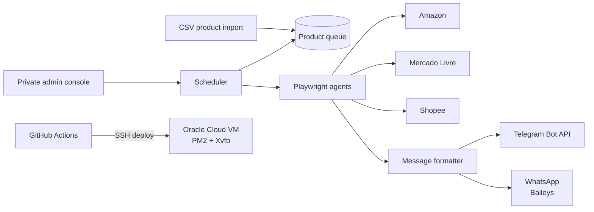

# Affiliate Deals Bot

**An autonomous bot that finds deals on Amazon, Mercado Livre and Shopee, generates affiliate links with browser agents and publishes them to Telegram and WhatsApp around the clock.**

Personal project · Running on Oracle Cloud · Source code is private (contains marketplace automation)

<!-- TODO: add a 5-second GIF of the bot posting a deal in Telegram (public/projects/bot.gif) -->

---

## The Problem vs. The Solution

**Problem:** Running affiliate channels means hours every day hunting deals, generating a link in each marketplace's affiliate portal and posting by hand. Mercado Livre and Shopee don't offer a public API for generating affiliate links, so it can't be solved with a simple API integration.

**Solution:** Browser agents that operate the affiliate portals the way a person would — log in, pick the product, generate the link — feeding a scheduler that formats and publishes posts to Telegram and WhatsApp without anyone touching it.

---

## Core Features

- **Automates** affiliate-link generation on Amazon, Mercado Livre and Shopee with Playwright browser agents.
- **Publishes** formatted posts (photo, price, highlights, CTA, disclosure) to Telegram and WhatsApp on a schedule.
- **Queues** products imported from CSV and posts them every 20 minutes, keeping a minimum gap between stores.
- **Prevents** duplicate posts with a local history of what has already been published.
- **Deploys** on every push: GitHub Actions → SSH → Oracle Cloud VM → PM2 restart, with a headed browser running under Xvfb.

---

## Architecture



### Tech Stack

| Layer | Technologies |
|---|---|
| Runtime | Node.js |
| Automation | Playwright (browser agents), scheduled jobs |
| Messaging | Telegram Bot API, WhatsApp via Baileys |
| Data | JSON queue and post history, CSV import, Zod config validation |
| Cloud | Oracle Cloud VM (Linux), PM2, Xvfb |
| CI/CD | GitHub Actions with SSH deploy |

---

## Business Impact

- ✅ **3 marketplaces and 2 channels running unattended** — the daily manual routine went to zero.
- ✅ **800+ products** loaded into the posting queue.
- ✅ **~100 automated posts per day** configured: Shopee queue every 20 minutes plus store campaigns every 45 minutes.
- ✅ **Push-to-deploy:** every commit ships to production automatically.

<!-- TODO: add real numbers, e.g. "X clicks/month", "Y channel members", "Z sales generated" -->

---

## How to Run

The source code is private. For a walkthrough during a hiring process, contact me at [brunofdalmeida1@gmail.com](mailto:brunofdalmeida1@gmail.com).

```bash
# Local development (with access to the repo)
npm install
cp .env.example .env                                   # Telegram token, marketplace credentials
cp config/campaigns.example.json config/campaigns.json
npm run run:once                                       # one test cycle
npm start                                              # continuous mode
```
