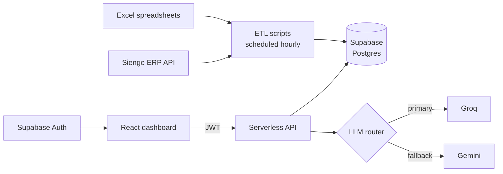

# AI Executive Dashboard

**A self-updating executive dashboard that replaced manual spreadsheet reporting at an engineering services company — and writes its own financial analysis with LLMs.**

Built in-house for Cetest Engenharia · Source code and data are private (company system)

<!-- TODO: add a screenshot or GIF with blurred/fake numbers (public/projects/dashboard.png) -->

---

## The Problem vs. The Solution

**Problem:** Leadership needed to follow revenue, cash flow, P&L, HR, payroll, safety and procurement, but the data lived in scattered Excel files and in the Sienge ERP. Reports were built by hand, took time to assemble and were already out of date when they arrived.

**Solution:** An automated pipeline that pulls every source into Supabase on a schedule, a React dashboard with one screen per business area, and an AI "CFO report" that reads the live numbers and writes the analysis for the executives.

---

## Core Features

- **Synchronizes** Excel spreadsheets and the Sienge ERP API into Postgres every hour on business days, with no manual step.
- **Consolidates** 10+ business modules — P&L, cash flow, billing, HR, payroll, benefits, safety, occupational health, procurement and contracts — behind one login.
- **Analyzes** the numbers with an LLM that streams an executive-style analytical report directly in the dashboard.
- **Falls back** automatically from Groq to Gemini, so AI reports keep working if one provider is down.
- **Filters** every screen by year, month and company through shared global filters.

---

## Architecture



### Tech Stack

| Layer | Technologies |
|---|---|
| Frontend | React 18, Vite, Tailwind, Chart.js, jsPDF |
| Backend | Serverless API functions (Vercel pattern), Node.js |
| Data | Supabase (PostgreSQL), ETL from Excel and the Sienge ERP API |
| Auth | Supabase Auth with JWT sessions |
| AI | Groq (`gpt-oss-120b`) with automatic fallback to Google Gemini, streaming responses |
| Automation | Scheduled jobs (Windows Task Scheduler + PowerShell) |

---

## Business Impact

- ✅ **Reporting went from manual and periodic to automatic, every hour** on business days.
- ✅ **One login-protected source of truth** for the whole leadership team instead of scattered spreadsheets.
- ✅ **AI-written analysis** turns raw numbers into an executive narrative in seconds.

<!-- TODO: add real numbers, e.g. "saved ~X hours/week of report preparation", "N executives use it daily" -->

---

## How to Run

The source code and data belong to the company and are private. Happy to walk through the architecture and code in an interview.

```bash
# Local development (with access to the repo)
npm install
cp .env.local.example .env.local   # Supabase, Sienge and Groq/Gemini credentials
npm start                          # API on :3002 + Vite on :3001
```
