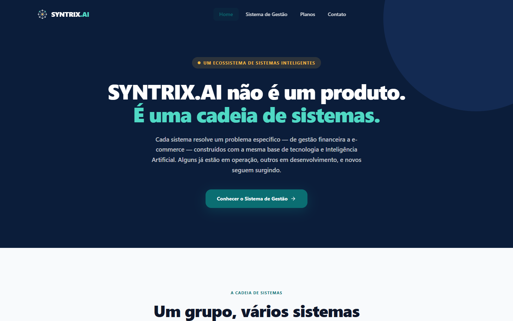
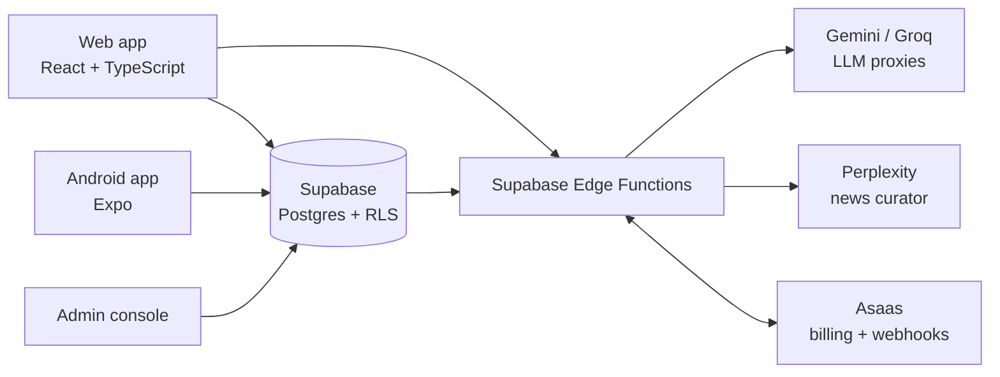

# SYNTRIX.AI

**An AI-powered financial and operational management SaaS for small and mid-sized businesses — finance, inventory, point of sale and BI in one multi-tenant platform, with built-in AI agents.**

🌐 [syntrix.com.br](https://syntrix.com.br) · Founder, designed and built solo · Source code is private (commercial product)



<!-- TODO: add a screenshot or 5-second GIF of the logged-in dashboard (public/projects/syntrix-dashboard.png) -->

---

## The Problem vs. The Solution

**Problem:** Small and mid-sized businesses juggle payables, receivables, cash, inventory and sales across spreadsheets and disconnected tools. Reconciling it all is manual, slow and error-prone, so the owner never has a clear, current picture of cash flow.

**Solution:** A cloud-native, multi-tenant platform that brings every financial and operational workflow into one place, and puts AI agents on top of the data — to explain cash flow, answer users' questions inside the app, write the narrative behind BI dashboards and watch for security anomalies.

---

## Core Features

- **Centralizes** payables, receivables, bank reconciliation, cash control and credit cards per company (tenant), isolated with Postgres Row-Level Security.
- **Runs** inventory, point of sale (POS), orders, returns, commissions and sales goals in the same system as the financials.
- **Analyzes** each workspace with AI agents: *Syn-Advisor* (cash-flow insights), *Syn-Support* (in-app assistant with handoff to a human) and AI-written BI narratives.
- **Protects** the platform with *Sentinel*, a security monitor that logs auth failures, sensitive-data access and rate-limit hits server-side.
- **Bills** subscriptions automatically through the Asaas payments API, with checkout, trials and webhooks.

---

## Architecture



LLM calls never leave the browser with an API key: the client calls an Edge Function, which holds the secret and talks to the model provider.

### Tech Stack

| Layer | Technologies |
|---|---|
| Frontend | React 19, TypeScript, Vite, Tailwind, Recharts |
| Mobile | Expo (React Native), Android |
| Backend | Supabase: PostgreSQL with Row-Level Security, Auth, Edge Functions (Deno) |
| AI | Google Gemini, Groq, Perplexity — prompt-engineered agents behind server-side proxies |
| Payments | Asaas API (subscriptions, checkout, webhooks) |
| Cloud | Vercel (web), Supabase (database, auth, functions) |

---

## Business Impact

- ✅ **Live in production** at syntrix.com.br, built end to end by one person — product, architecture, code and billing.
- ✅ **One system instead of several:** finance, inventory, POS and BI share the same data, so cash flow reflects sales and stock in real time.
- ✅ **Secure by design:** tenant isolation enforced in the database (RLS) and AI/API secrets kept server-side.

<!-- TODO: add real usage numbers, e.g. "X companies onboarded", "Y transactions processed", "reconciliation time cut from N hours to M minutes" -->

---

## How to Run

The source code is private. For a walkthrough or code review during a hiring process, contact me at [brunofdalmeida1@gmail.com](mailto:brunofdalmeida1@gmail.com).

```bash
# Local development (with access to the repo)
npm install
cp .env.example .env.local   # Supabase URL/keys, Gemini/Groq keys, Asaas sandbox key
npm run dev
```
